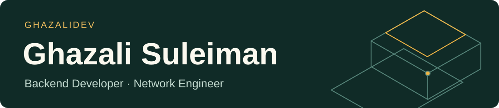

I build software for the people running day-to-day operations. My work spans backend services, network infrastructure, and the integrations that connect them.

[Visit my portfolio](https://ghazalidev.com/) · [Connect on LinkedIn](https://www.linkedin.com/in/ghazali-sulieman)

## Selected work

### Wasaati
A real estate CRM that follows an inquiry from first contact to a property viewing. Agents manage leads, match requests to listings, and schedule visits. A voice assistant handles initial questions and directs callers to WhatsApp for follow-up.

[Explore Wasaati ↗](https://wasaati.com/)

### Moeen
Hajj operations teams receive circulars and incident reports that need an owner and a deadline. Moeen uses AI to classify incoming reports, routes them to the responsible team, and tracks each item through closure.

[Explore Moeen ↗](https://moeenai.com/)

### Nutqi
Staff tools for a nonprofit supporting children with speech and language needs. My work connects appointment workflows, reminders, and staff notifications with the association’s phone and network infrastructure.

### Yamam Agency
A bilingual website for a Doha-based creative agency, bringing its services and portfolio together for Arabic- and English-speaking clients.

[Visit Yamam Agency ↗](https://yamamagency.com/)

## Engineering toolkit

| Area | Technologies |
| --- | --- |
| Backend services | Laravel, PHP, ASP.NET Core, C#, Node.js, Python |
| Web interfaces | React, Next.js, TypeScript |
| Data | MySQL, SQL Server, MongoDB |
| Networks and operations | DNS, SIP, VoIP, Docker, hosting |
| Systems integration | REST APIs, n8n, voice assistants, notification workflows |

**Education** · BSc (Honours) in Information Technology, University of the Red Sea, 2018
